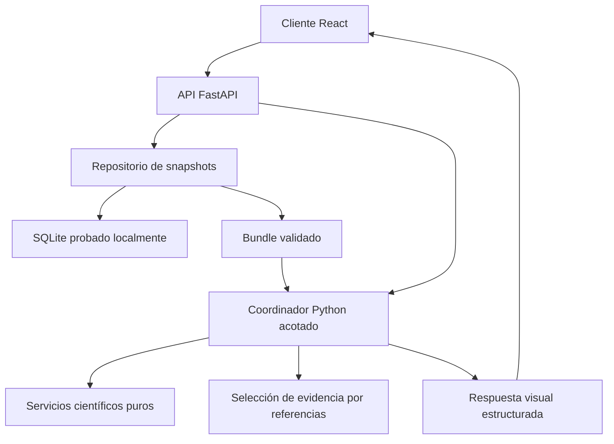

# Arquitectura

La base local implementa el recorrido descrito, con un arnés técnico React, FastAPI, contratos Pydantic,
herramientas puras Python y SQLite. El proveedor externo está preparado y probado mediante transporte
simulado; PostgreSQL/pgvector, CI remoto y frontend de producto siguen pendientes de ejecución o desarrollo.
El código no está publicado. Resultados exactos: [VERIFICATION](VERIFICATION.md).

## Un recorrido vertical

La arquitectura conecta una interfaz técnica, una API, servicios científicos, un coordinador de IA y persistencia. Los módulos intercambian contratos compartidos; el modelo de lenguaje no decide formatos de respuesta libremente.

## Límites de responsabilidad

- **API:** valida solicitudes, organiza dependencias, expone contratos y traduce errores.
- **Dominio:** tipos y restricciones compartidas. No importa frontend ni proveedor de IA.
- **Datos:** ingesta, persistencia, identidad, procedencia y catálogo.
- **Ciencia:** perfiles, elegibilidad, ranking, comparación y estadísticas. No requiere un LLM para calcular.
- **IA:** coordina un flujo fijo de herramientas sobre filtros explícitos. El modo demo explica de forma determinista; el adaptador externo puede sintetizar los resultados sin reemplazar cálculos. Planificación libre de lenguaje natural permanece como ampliación.
- **Cliente:** presenta respuestas y mantiene interacción. No contiene secretos ni recalcula silenciosamente reglas científicas.

## Persistencia

SQLite permite iniciar y verificar el esqueleto sin Docker. PostgreSQL con pgvector es el objetivo de integración compartida. Cuando exista un contenedor o extensión, eso no demostrará por sí solo recuperación vectorial poblada: consulta [IMPLEMENTATION_STATUS](IMPLEMENTATION_STATUS.md).

SQLAlchemy y Alembic almacenan bundles JSON validados como snapshots por hash, un puntero al corpus
activo y expedientes de investigación ligados al snapshot usado. La importación repetida del mismo contenido
es idempotente; sustituir otro corpus exige una opción explícita. El informe y la evidencia de una investigación
guardada no se recalculan a partir del corpus nuevo. No es todavía un almacén relacional de cada observación
ni un índice vectorial. SQLite usa fichero; el modo en memoria se rechaza para evitar perder migraciones entre conexiones.

La interfaz del repositorio evita que las herramientas dependan de detalles del motor. Las migraciones pertenecen a P1. Los datos científicos se incorporan con un proceso explícito; no se transforman fixtures en producción mediante renombrado.

## Contratos y generación

Los modelos ejecutables están en `apps/api/src/flamelab/domain/contracts.py`; CONTRACT_MODELS explica las
restricciones y CONTRACTS las operaciones. Los artefactos de `packages/contracts` se generan desde la API.
Un cambio incompatible necesita revisión de P1 y del consumidor, regeneración y prueba de integración.

La respuesta de investigación conserva estado, evidencia, análisis, acciones visuales y limitaciones según el contrato vigente. El frontend solo interpreta componentes permitidos; no ejecuta JavaScript emitido por un LLM.

## Modos de ejecución

- **Demostración:** funcionamiento determinista y explícito, sin llamada de pago. Puede utilizar fixtures sintéticos.
- **Proveedor externo:** modelo configurable en el servidor, con esquema validado, tiempo límite y errores controlados. No cambia reglas de ciencia.
- **Datos reales:** el catálogo de 24 investigaciones es `metadata_only`, separado del bundle demo. Una serie cuantitativa real se habilitará tras revisar granularidad, unidades y procedencia. No es sinónimo de proveedor externo.

Son dimensiones diferentes: una llamada real a IA puede analizar datos sintéticos, y un análisis determinista puede operar sobre datos reales. La UI debe conservar ambas distinciones.

## Ampliaciones

A2UI, recuperación multimodal, regresión, visión por computador, selección activa de experimentos y regresión simbólica son ampliaciones. Se añaden cuando el recorrido central y sus contratos permitan demostrar una mejora concreta. No se introduce una segunda base vectorial sin una decisión explícita.

El flujo inicial no incorpora LangGraph: ADR 0007 elige Python directo porque no necesita un grafo dinámico
ni estados de trabajo en cola. Evidence Canvas, Mission Lab y diseño inverso mantienen su ambición documental;
el arnés actual comprueba contratos y escenarios A/B, no implementa un simulador físico ni el frontend final.
